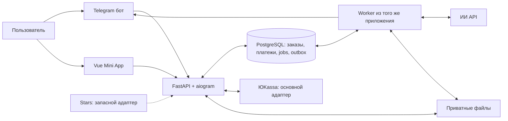

# «Сказка с тобой»: архитектура первой версии

Статус: проект для явного согласования, реализация не начата. Дата исследования: 01.11.2026.

## 1. Исходные материалы и границы

Изучены рабочее дерево, git status, README.md и официальные источники ниже. В репозитории только README с названием fairytale-bot; исходного кода, зависимостей, конфигурации и документации нет. Рабочее дерево до подготовки документа чистое. AGENTS.md в каталоге проекта и проверенных родительских каталогах не найден. Переписка, аудио, фотографии и ссылки на референсы сверх текста задания не предоставлены; их содержание не предполагается.

Подтверждено заказчиком:

- Telegram-сервис, ребёнок — главный герой; сбор данных и фотографии, оплата, персональный PDF в Telegram.
- Ровно 10 страниц, 10 иллюстраций и 10 соответствующих фрагментов текста. Текст размещается программно. Отдельной одиннадцатой обложки нет.
- ИИ API для сюжета и изображений; команда из двух разработчиков; сначала архитектура, затем реализация только по явному согласию.
- Уточнение во время исследования: **Mini App — основной интерфейс; ЮKassa — обязательный основной провайдер; Telegram Stars — необязательный запасной вариант**. Эти продуктовые решения заменяют первоначальное предложение обычного бота и Stars по умолчанию.

Предложения автора: один модульный Python backend с отдельным worker, PostgreSQL как хранилище и очередь, приватный диск, Vue Mini App, администрирование командами бота, один шаблон PDF и один иллюстративный стиль.

Допущения для расчётов и прототипа: русский язык; один ребёнок и одна фотография на заказ; аудитория 3–9 лет; до 100 заказов в сутки на старте, без обещанного SLA; один сервер; небольшая закрытая пилотная группа. Эти параметры ещё не требования заказчика. Масштаб и срок ожидания уточняются по измерениям.

Не входят в первую версию: печать и доставка книги, несколько детей, подписки, редактор готовой сказки, произвольные стили, голосовой ввод, бесплатные неограниченные перегенерации, публичные галереи и маркетплейс.

## 2. Формат продукта и администрирование

| Вариант | Удобство | Разработка и сопровождение | Вывод |
| --- | --- | --- | --- |
| Обычный бот | Удобен для коротких шагов и получения файла; редактирование анкеты и обзор заказов менее наглядны | Один клиент, меньше тестовых комбинаций | Был исходной рекомендацией по минимизации, после уточнения не основной |
| Бот + Mini App | Анкета целиком, предпросмотр фото, редактирование и библиотека заказов в одном месте | Нужны frontend, HTTPS API, авторизация, проверка мобильных WebView | **Основной, прямо выбран заказчиком** |

Бот: запуск, открытие Mini App, уведомления, выдача PDF, повторная отправка, поддержка. Mini App: анкета, загрузка, проверка, цена, состояние заказа, список сказок. Встроенный просмотр PDF необязателен: в MVP карточка и открытие/скачивание файла, без разработки PDF-reader.

Администрирование — закрытые команды бота в личном чате, allowlist числовых Telegram ID: список проблемных заказов, карточка этапов и затрат, повтор конкретного этапа, повтор доставки, запрос удаления, возврат с подтверждением. Фото по умолчанию скрыто; просмотр для разбора случая отдельно аудируется. Веб-панель и общий доступ к БД не нужны. Возвраты и повторы с расходами требуют отдельного подтверждения конкретного действия оператором.

### Условие публикации платёжного сценария

ЮKassa сохраняется основным обязательным требованием, Stars — запасным. При этом официальная документация Telegram требует Stars для цифровых товаров/услуг внутри бота и Mini App; наличие внешнего сайта само по себе исключения не даёт. Персональный цифровой PDF по описанному продукту относится к такому сценарию. Это ограничение платформы, а не изменение требований заказчика. См. [Telegram Digital Goods](https://core.telegram.org/bots/payments-stars) и [условия платформы, раздел 6.2](https://telegram.org/tos/bot-developers).

Технический адаптер ЮKassa и тестовый checkout проектируются ниже. Нельзя утверждать, что платёжная ссылка из Mini App делает цифровую продажу допустимой. До коммерческого запуска необходимо подтвердить допустимый канал продаж с Telegram либо отдельно согласовать самостоятельный веб-магазин с покупкой вне Telegram и роль Telegram только в доставке; допустимость конкретного процесса доставки тоже подлежит проверке. Такой сайт сейчас не включён автоматически. Замена на Stars не выполняется без решения заказчика. Разрешение заказчика на архитектуру не заменяет правила платформы.

## 3. Пользовательский путь

1. `/start`: понятный состав продукта, демонстрационный PDF на вымышленном персонаже, условия и кнопка Mini App.
2. Mini App авторизуется на сервере; показывает «Новая сказка», «Мои сказки», сохранённый черновик.
3. Создание draft-заказа до оплаты. Пользователь заполняет поля, сервер сохраняет каждый подтверждённый шаг. Возврат назад не очищает данные; уход из приложения показывает предупреждение, если изменения ещё не сохранены.
4. Загрузка одной фотографии, локальный preview, серверная проверка и нормализация. Ошибка оставляет предыдущую корректную фотографию; доступны замена и подсказки.
5. Выбор темы, необязательных интересов. Карточка проверки с редактированием любого поля.
6. Показ окончательной цены, состава «10 страниц / 10 иллюстраций / PDF», ограничений сходства, срока хранения, правил возврата и согласия на обработку фото внешним ИИ.
7. Сервер фиксирует неизменяемую версию анкеты и цены, создаёт попытку платежа ЮKassa. Конкретный коммерческий канал checkout зависит от условия публикации выше. Закрытие checkout не равно отказу или успеху: при возвращении сервер получает реальный статус.
8. Только серверное подтверждение оплаты ставит генерацию в очередь. Пользователь может закрыть Telegram; работа продолжится.
9. Реальные статусы: «В очереди», «Готовим историю», «Готовим образ героя», «Иллюстрации: готово 4 из 10», «Собираем PDF», «Проверяем», «Отправляем». Процент и гарантированное время не выдумываются.
10. Бот отправляет PDF; Mini App показывает готовый заказ и кнопку повторной отправки/скачивания. Повтор использует сохранённый файл, без ИИ-запросов.
11. После исчерпания повторов — «Нужна помощь, заказ сохранён», номер заказа, связь с поддержкой; оператор восстанавливает этап или оформляет возврат. Пользователь не платит второй раз за техническое восстановление.

Пока оплата pending, редактирование требует закрытия старой попытки/сверки статуса: оплачивается ровно зафиксированная версия. После оплаты анкета не меняется. Просроченные ссылки не запускают генерацию с другой версией; запоздалый подтверждённый платёж переводится в разбор/возврат, а не теряется. Новый заказ не удаляет старый. Список заказов пагинируется.

### Предлагаемые поля

| Поле | Зачем | Ограничение |
| --- | --- | --- |
| Имя героя | Персональное обращение | 1–40 символов; без фамилии; разрешить домашнее имя |
| Возрастная группа: 3–5 / 6–7 / 8–9 | Сложность текста и темы | Без даты рождения; диапазон — предложение для MVP |
| Форма обращения/местоимения | Русское согласование | Явный выбор, не угадывать по фотографии |
| Фото | Визуальный референс | Один ребёнок, лицо видно, без посторонних; JPEG/PNG до 10 МБ, нормализация до 1536 px; лимиты проверяются прототипом |
| Тема: лес / космос / море | Управляемый выбор приключения | Три проверенных набора, один по умолчанию |
| Интересы, необязательно | Дополнительная персонализация сюжета | До трёх из подготовленного списка, без свободных чувствительных данных |
| Согласия | Условия покупки, фото и внешний обработчик | Версия текста, время принятия; не совмещать с маркетингом |

Стиль не поле MVP: единая мягкая книжная иллюстрация уменьшает нестабильность и стоимость проверки. Пол, фамилия, адрес, школа, геолокация и точная дата рождения не нужны. Контакт для чека, если потребуется по настройкам магазина, запрашивается отдельно и хранится отдельно от промптов.

## 4. UI и визуальная система

Vue 3, Composition API, TypeScript, Vite; PrimeVue **ветки 4.x**, готовый Aura preset в Styled Mode, PrimeIcons, PrimeVue Forms со схемной валидацией. Tailwind не нужен на старте; небольшая CSS-сетка для композиции. Все подписи, ошибки, пустые состояния и локаль — русские. Пользовательскую логику заказов, загрузок, API, платежей и восстановления всё равно пишем самостоятельно; библиотека предоставляет стандартное поведение компонентов.

Почему явно 4.x: на дату исследования актуальный сайт показывает PrimeVue 5.0.4 и шаг с PrimeUI license key. Нельзя автоматически объявлять последнюю ветку бесплатной MIT. Для тега 4.4.1 проверена MIT-лицензия; доступна отдельная документация v4 и Aura. Предлагается зафиксировать проверенный 4.x patch в прототипе с Vue 3 и Vite, без платных шаблонов. Срок активных исправлений безопасности v4 не установлен этим исследованием: до фиксации зависимостей проверить политику поддержки. Если приемлемой поддержки нет, вынести на согласование миграцию или стоимость лицензии v5, не покупать её молча. Совместимость сборки будет проверена, а не выдаваться за уже выполненный тест.

Общий дизайн: светлый тёплый фон, тёмный контрастный текст, один акцент, крупная основная кнопка, одна колонка на телефоне, минимум декоративных картинок вне примера. Aura отвечает за состояния, фокус, поля и диалоги. Проверяются клавиатура, screen reader labels, контраст, Telegram dark/light, safe area, изменение viewport и экранная клавиатура. Не полагаться на библиотеку как на автоматическую гарантию доступности приложения.

| Экран | Задача | Готовые компоненты | Настройки |
| --- | --- | --- | --- |
| Главная/пример | Понять результат, начать | Card, Image, Button, Message | Демопример без реального ребёнка, состав и цена с сервера |
| Анкета | Ввести и исправить данные | Stepper, Form, InputText, Select, SelectButton, MultiSelect, Checkbox | Схема, inline errors, лимиты, русский язык, автосохранение с индикатором |
| Фотография | Загрузить и проверить | FileUpload, Image, Message, Button | Один файл, MIME/размер, custom upload на API, серверная валидация |
| Проверка/оплата | Сверить заказ | Card, Divider, Button, ConfirmDialog, Message | Версия анкеты, цена и состав, состояние попытки, provider checkout вне собственной формы карты |
| Ожидание | Понять этап | Timeline, Tag, ProgressSpinner, Message | Только реальные события, polling с backoff, без фиктивных процентов |
| Мои сказки | Открыть и получить PDF | DataView, Card, Tag, Paginator, Button | Только свои заказы, срок доступности, повтор отправки |
| Ошибка/удаление | Восстановиться или удалить | Message, Dialog, ConfirmDialog, Button | Номер заказа, поддержка, явное подтверждение удаления |

Предоставленных референсов нет. Предложения автора: [Wonderbly](https://www.wonderbly.com/) — демонстрация персонализации до покупки и понятные возрастные группы, без копирования материалов; [официальный Telegram пример DurgerKingBot](https://core.telegram.org/bots/webapps) — короткий мобильный сценарий и интеграция с окружением Telegram; [Aura v4](https://v4.primevue.org/theming/styled/) — единая готовая визуальная основа. Это примеры, а не пожелания заказчика.

## 5. Основной стек и развёртывание

| Компонент | Выбор и назначение | Причина |
| --- | --- | --- |
| Backend | Python 3.12, FastAPI, Pydantic | Типизированное API, валидация, одна кодовая база с генерацией и PDF |
| Бот | aiogram 3.x | Асинхронная работа с Telegram, готовые типы/обработчики; UI FSM не источник состояния заказа |
| БД | PostgreSQL 18, SQLAlchemy 2, Alembic, psycopg | Транзакции платежа и jobs, блокировки, миграции |
| Worker | Отдельный процесс того же приложения | Долгие задания переживают закрытие WebView и HTTP |
| Очередь | Таблица jobs в PostgreSQL | Нет Redis и дополнительного брокера для малого потока |
| ИИ | Официальный OpenAI SDK через собственные адаптеры | Версии промптов, учёт затрат и замена модели без изменения домена |
| Файлы | Приватный persistent volume на одном сервере | Фото/иллюстрации/PDF не требуют S3 на старте |
| PDF | ReportLab OSS, Pillow, pypdf; qpdf/Poppler для проверки | Контролируемая геометрия, кириллица; без отдельного браузера для печати |
| HTTPS | Caddy, один домен, Vue static + API | Нужен Mini App и webhook ЮKassa; сертификаты автоматически |
| Запуск | Docker Compose: app, worker, db, proxy | Простой воспроизводимый запуск двумя разработчиками |

Версии patch и совместимость фиксируются lock-файлами только на этапе реализации. Новый FastAPI HTTP-сервис обоснован Mini App и ЮKassa, а не добавлен ради микросервисов. App обслуживает API и Telegram webhook; worker выполняет генерацию и outbox доставки. Никакой генерации в HTTP handler. На старте один app и один worker. Ограничение — один сервер, не высокая доступность. Начальная гипотеза ресурсов: 2–4 vCPU, 4–8 ГБ RAM, SSD от 50 ГБ; подтвердить нагрузкой и объёмом хранения.

Объектное хранилище потребуется при нескольких узлах/росте диска, внешний брокер — только при измеренной нехватке PostgreSQL-очереди. Их нет в MVP.



Внешний checkout показан как техническая интеграция; схема не подтверждает допустимость канала цифровой продажи в Telegram.

## 6. Модель данных и состояния

| Сущность | Ключевые данные и связи |
| --- | --- |
| User | UUID, unique telegram_user_id bigint, language, timestamps; username не идентификатор |
| Order | UUID, user_id, draft/current snapshot, version, execution_status, product/template/prompt versions, price_quote, accepted_payment_id |
| Consent | user_id/order_id, version, scope, accepted_at |
| PaymentAttempt | order_id, provider, unique provider_payment_id, idempotency_key, expected amount/currency, status, provider timestamps, failure reason |
| PaymentEvent | provider + object_id + event_type unique, verified status, processed_at; без лишних персональных данных |
| Story | order_id + revision, character bible, style, plot, validated scenario JSON |
| Page | story_id + page_number unique 1..10, text, prompt, illustration_asset_id, validation status |
| Asset | order_id, kind, private storage_key, checksum, MIME, size, created_at, expires_at, deleted_at; Telegram file_id для доставки отдельно |
| Job | order_id, stage, page/revision, status, attempt, next_run_at, lease_until, fencing_token, error; unique логическая задача |
| AIRequest | job_id, attempt, model, request_hash, provider_request_id, status, usage, estimated/actual_cost, budget reservation |
| Outbox | order_id, event/action, unique deduplication_key, delivery status/attempts, Telegram message_id/file_id |
| AuditEvent | actor, order_id, action, time, sanitized metadata |

Order execution: `draft → awaiting_payment → queued → scripting → character_reference → illustrating → composing → validating → ready`. Отдельно `needs_attention`, `canceled`, `deleted`. Сбой доставки не уничтожает `ready`; доставка хранится в Outbox. Возврат не стирает уже созданный результат, но закрывает новые расходы/доступ по согласованной политике.

PaymentAttempt: `created → pending → succeeded | canceled`; локально `unknown` при неопределённом ответе; возвраты отдельными записями с `requested/pending/succeeded/failed`, включая частичные при необходимости. `waiting_for_capture` распознаём, но для MVP выбираем одностадийную оплату с capture=true. Состояние оплаты заказа выводится из принятых платежей/возвратов, а не из этапа генерации. Ошибка ИИ не делает платёж неоплаченным.

Инварианты: результат только из оплаченного snapshot; не больше одного принятого платежа на заказ; 10 уникальных страниц; готовая страница имеет сохранённую иллюстрацию; PDF становится ready только после проверок; удалённый заказ нельзя автоматически возобновлять. Реальная вторая оплата — отдельное поступление для возврата/разбора, не просто игнорируемое событие.

## 7. Оплата и доверие к событиям

### ЮKassa — обязательный основной адаптер

1. Сервер создаёт order/snapshot и цену в RUB целым числом копеек. Не принимать цену/скидку от клиента. Настройки магазина, налоги, чек и договор определяются до production.
2. PaymentAttempt и постоянный Idempotence-Key сохраняются **до** create payment. Сервер использует credentials своего shop, metadata с order/attempt, capture=true, разрешённый return_url. Сохраняет payment_id и confirmation_url. Return URL — только навигация, не подтверждение оплаты.
3. Webhook `payment.succeeded` — сигнал для проверки. Не предполагаем наличие универсальной криптографической подписи ЮKassa. Сверяем отправителя по актуальной документации и обязательно запрашиваем объект платежа сервер-сервер через authenticated GET. Проверяем shop/recipient, provider id, metadata связи с нашей попыткой, amount/currency, succeeded и paid. Не доверять одному JSON webhook.
4. Проверка и принятие выполняются под блокировкой заказа. В одной БД-транзакции: запись события, фиксация принятого платежа, queued и job. Повтор события возвращает успешный HTTP ответ без второго job.
5. Webhook сначала надёжно сохраняется в inbox; обработка проверки повторяется worker. При сбое БД не отвечать, будто событие принято. Секреты и полный платёжный payload не логируются.
6. Периодическая сверка pending/unknown платежей и оплаченных заказов без job восстанавливает пропущенные уведомления. При потере create-ответа повтор с тем же Idempotence-Key в документированном окне; после истечения окна не создавать новый платёж вслепую, нужна сверка/оператор. Окно идемпотентности ЮKassa — 24 часа по текущей документации.
7. Refund использует собственную сохранённую идемпотентную попытку и API провайдера; статус подтверждается сервером. Перед возвратом остановить новые jobs, учесть уже выполняющиеся запросы, поставить запрет на последующую автоматическую доставку.

Поддержка test shop, повторных/переставленных событий, отказа и закрытия checkout обязательна. Комиссия ЮKassa и фискализация не оценены без договора и конфигурации продавца; не входят в цену ИИ.

### Stars — запасной необязательный адаптер

Реализуется только если отдельно включён в согласованный объём. Технический сценарий: sendInvoice в личном чате с XTR, пустым provider_token и одной позицией цены; opaque payload связан с попыткой, пользователем и snapshot. pre_checkout: сумма/валюта/владелец/неоплаченность, ответ в пределах 10 секунд. Генерация только по проверенному successful_payment, а не по pre_checkout или клиентскому callback. Сохранить unique telegram_payment_charge_id, payer и payload; обработать дубли. Возврат — refundStarPayment. Команды /terms, /support и /paysupport; сверка через getStarTransactions. Курс Stars к чистой выручке не считать фиксированным рублёвым курсом.

## 8. Авторизация, фото и права

Mini App передаёт raw initData по HTTPS. Backend проверяет HMAC по официальному алгоритму WebAppData, constant-time comparison, auth_date (предлагаем максимум 5 минут), обязательный user.id и формат; initDataUnsafe не доверяем. После проверки выдаётся короткая серверная сессия, без токена бота в frontend. Защита от повторного использования устаревшего initData, rate limit и ограничение попыток обязательны. Для cookie-сессий: Secure/HttpOnly, CSRF и явный same-origin CORS; поведение cookie проверить в Telegram WebView. Идентификатор владельца всех операций берётся из сессии.

Telegram webhook защищён secret_token header и HTTPS, update_id дедуплицируется до изменения состояния. Все выборки orders/assets включают user_id; UUID сам по себе не разрешение. Пользователь видит только своё, редактирует только draft, может скачать в срок хранения, запросить удаление и поддержку. Администратор получает ограниченные операции через отдельный allowlist; действия аудируются, финансовый статус вручную «paid» не выставляется.

Файлы вне web root, случайные storage keys; никакой постоянной публичной ссылки. Upload проверяет сигнатуру/декодирование, размеры и число пикселей, EXIF orientation, удаляет EXIF, повторно кодирует; не доверять расширению/MIME клиента, запретить SVG и архивы. Список форматов JPEG/PNG; HEIC — понятная инструкция конвертации, без скрытого обещания поддержки. Фото в Telegram тоже можно принять через бота как альтернативный ввод; URL getFile содержит bot token, не сохраняется в логах и не передаётся публично. Провайдеру отправлять байты/закрытый upload, не публичный URL.

Предложение для согласования: черновики 7 дней; исходное фото и reference-материалы — до 7 дней после готовности/окончательной ошибки; иллюстрации и PDF — 30 дней; временные файлы — 24 часа; очищенные технические логи — 30 дней. Финансовые записи хранятся отдельно по применимым требованиям, срок определяет оператор с бухгалтерией. Интерфейс заранее сообщает, до какой даты доступно повторное скачивание.

Удаление отзывает доступ сразу, ставит tombstone, отменяет queued jobs и доставку; уже запущенный запрос может завершиться — его выход удаляется, новые этапы запрещены. Очистка удаляет файлы, фото в snapshot и персональные промпты, сохранённые Telegram file_id. Удаление наших копий не означает удаление файла, уже полученного пользователем/Telegram. Копии у ИИ-провайдера подчиняются его правилам: store=false не даёт обещания нулевого хранения; стандартные abuse-логи OpenAI могут храниться до 30 дней, есть исключения. Это должно быть отражено в согласии.

## 9. Генерация, сохранение и восстановление

Конвейер: validate input → character description + structured script → локальная проверка текста → character sheet → 10 page illustrations → quality checks → PDF → validate PDF → delivery outbox.

Worker выбирает jobs через SELECT FOR UPDATE SKIP LOCKED, ставит lease и фиксирует транзакцию до сетевого вызова. Нет долгой БД-транзакции во время ИИ. Heartbeat продлевает lease; fencing token запрещает устаревшему worker публиковать результат. Истёкший lease у незавершённого сетевого вызова переводит попытку в unknown для сверки, а не немедленно выдаёт её другому worker.

Стартовые ограничения: два активных заказа, максимум два изображения одновременно глобально, одна сборка PDF; настройки в конфигурации. Жёсткий глобальный лимит обеспечивается БД-слотами/lease, а не только semaphore процесса. Внутри заказа сначала reference, затем независимые сцены с тем же reference. Сетевые тайм-ауты: connect 10 с, текст до 120 с, изображение до 300 с; это инженерные лимиты для прототипа, не SLA провайдера. Контроль общей длительности и дневного денежного бюджета.

429 и подтверждённые временные ошибки — ограниченный backoff с jitter и Retry-After; максимум три попытки этапа, максимум два повторных изображения на сказку сверх исходных десяти до передачи оператору. Лимит денег имеет приоритет над числом повторов. Ошибки ввода, запреты контента и неподдерживаемые параметры не повторять автоматически. SDK retries отключить или включить в общий счётчик, чтобы не получить скрытые повторные расходы.

Каждый этап имеет version/hash входов. Промпт, модель, номер попытки, usage, время и безопасные коды ошибок сохраняются; персональные данные не попадают в обычный лог. Сценарий сохраняется целиком до картинок. Каждая картинка сначала пишется во временный файл, проверяется, затем atomic rename в детерминированный путь и запись Asset с checksum. После сбоя незарегистрированные готовые файлы сверяются и подхватываются, частичные удаляются. Повтор пятой иллюстрации не регенерирует первые четыре. Изменение сценария требует новой revision и явного определения зависимых страниц, не смешиваем разные версии.

### Запрос оплачен у провайдера, ответ потерян

До запроса записываем AIRequest, резервируем бюджет и client request identifier; после ответа немедленно сохраняем provider id/usage и артефакт. Наличие клиентского ID или X-Request-ID **не означает**, что Images API гарантирует идемпотентную генерацию или повторное скачивание.

Если есть поддерживаемый provider operation/response id, проверяем результат по документированному API. Для прямого Images edits нельзя обещать восстановление потерянных bytes по одному request id. При неопределённости — `unknown`, ожидание/сверка доступных usage и ручной разбор. Списание бюджета учитывается консервативно даже без файла. Дополнительный запрос разрешается только как новая платная попытка в пределах согласованного резерва, с записью риска двойной оплаты. Exactly-once внешний платный вызов без поддержки провайдера не обещается.

Отправка Telegram также не имеет общей exactly-once гарантии: outbox защищает от обычных дублей, но потеря ответа sendDocument может дать повторную доставку при восстановлении. Это приемлемее потери оплаченного PDF; повтор не запускает ИИ. Если бот заблокирован, ready сохраняется, доставка откладывается до нового /start.

Ежедневно: зашифрованный off-host backup БД и приватных файлов с manifest/checksum; 7 ежедневных копий как стартовая политика, тест восстановления на отдельном окружении. Для согласования RPO 24 ч и RTO 4 ч. Очистка по expires_at, disk-watermark и учёту активных leases; после восстановления backup повторно применяются tombstones, чтобы не воскресить удалённые фото. До подтверждённого tombstone replay пользовательский доступ закрыт. Мониторим heartbeat worker, возраст очереди, ошибки оплаты, unknown запросы, бюджет, свободный диск и backup age.

## 10. ИИ-связка и сценарий

Основная: **gpt-5.6-terra** через Responses API для описания фотографии, сценария и проверки текста; **gpt-image-2.5-sunburst** через Images edits с фото/референсом для character sheet и страниц. Terra поддерживает image input и structured outputs; Sunburst выбран ради редактирования по референсу. Модели задаются конфигурацией; точные версии и доступ аккаунта проверяются в прототипе. Не использовать GPT-4.1/GPT-5 Mini как новый default: текущие карточки помечают их deprecated.

Одна альтернативная связка: тот же gpt-5.6-terra + **gpt-image-2.5-flare**. Flare официально позиционируется для более быстрой повседневной генерации, принимает фото; сравнить на одинаковом сценарии. Это альтернатива картинки, а не независимый резерв на случай недоступности OpenAI. Второй провайдер не добавляется без подтверждения доступности и отдельного выбора.

API-доступ не проверен реальным ключом. OpenAI публикует список поддерживаемых стран, Россия в просмотренном списке не найдена. Страна оператора, инфраструктуры, аккаунта и договорная доступность — существенный вопрос до запуска; местоположение нельзя вывести из русского языка или timezone. Обход ограничений не является частью архитектуры. Если сервису недоступен выбранный API, нужна отдельная согласованная замена и новый расчёт.

Схема сценария (контракт, не прикладной код):

```text
schema_version, language="ru", title
character: name, age_band, pronouns,
  observed_features, uncertain_features, invariant_appearance, outfit, reference_asset_id
style: palette, medium, lighting, composition_rules, forbidden_visuals
plot: theme, interests, goal, conflict, resolution, safety_rules
pages[ровно 10]:
  number: 1..10
  story_beat, text_ru, illustration_prompt,
  scene: location, action, emotion, camera,
  continuity: outfit, props, character_reference_ids,
  must_include, must_not_include
```

JSON Schema strict, additionalProperties=false; Pydantic повторно проверяет длину массива, уникальные номера, обязательные строки, лимиты. Отказ модели/обрыв/невалидный JSON — отдельные результаты, не готовый сценарий. Целевой текст 45–70 русских слов на страницу, верхняя граница 90; финальная пригодность определяется измерением в PDF, не одним числом символов. Имя и факты из анкеты не подменяются; свободный пользовательский ввод — данные, не инструкции модели. Сюжет имеет начало, развитие и завершение в пределах десяти страниц; без опасных советов, сексуализированного контента и пугающих для выбранного возраста сцен.

### Узнаваемость героя

Из фото выделяем только видимые признаки, не диагнозы, происхождение или другие чувствительные выводы. Фиксируем волосы, форму причёски, видимые особенности, возрастной образ и одну одежду. Сначала создаём отдельный служебный character sheet: лицо, три четверти и полный рост в выбранном стиле. Он не добавляется в PDF и учитывается в себестоимости.

Каждая сцена получает **оригинальное фото + один утверждённый character sheet**, invariant appearance и один style block. Не строим цепь только от предыдущей картинки: это накапливает дрейф. Не рассчитываем на seed или одинаковый текст как гарантию. Все десять страниц сравниваются с исходником и общей контактной таблицей. Автоматическая visual-модель помогает найти смену волос/одежды/возраста и несоответствие сцене; не заменяет оценку взрослого и не даёт биометрическую гарантию.

В прототипе два взрослых оценщика проверяют узнаваемость и согласованность; при пилоте — ручной контроль перед отправкой. Предлагаемый порог: минимум 8 из 10 первичных сцен узнаваемы обоим, после максимум двух повторов все 10 приемлемы; если не достигнуто, автоматическую продажу не открывать и пересмотреть связку/качество/условия продукта. Нельзя обещать точную копию лица или стопроцентное сходство до проверки. Превью с утверждением героя пользователем — возможное расширение, сейчас не включено в путь после оплаты.

## 11. Себестоимость и денежные ограничения

Факты тарифов из официальных страниц, USD за 1 млн токенов, без налогов: Terra input $2, output $12. Sunburst/Flare Standard: text input $5, image input $8, image output $30. Batch дешевле, но в MVP не используется. Скидка cached input в прямом Images edits не предполагается. Качество/размер не задают универсальную фиксированную цену картинки: считать по usage.

Ниже **плановые допущения о токенах**, не измеренный тариф за картинку. Для прототипа 1024×1024, quality=medium; размер/качество окончательно выбираются по результатам. В модельных расходах включён служебный reference, но в пользовательском PDF только 10 картинок.

| Статья | Допущение | Оценка USD |
| --- | --- | --- |
| Сценарий, описание фото, QA | Совокупно 20 000 input + 12 000 billable output Terra; image input включён в input после пересчёта провайдером | 0.184 |
| Character sheet | 1 000 text input + 2 000 image input + 4 000 image output | 0.141 |
| 10 иллюстраций | На каждую 1 000 text input + 4 000 image input для фото и sheet + 4 000 image output | 1.570 |
| Два повторных изображения | Те же условные объёмы | 0.314 |
| Ещё один проход текста/QA | 10 000 input + 6 000 output | 0.092 |
| Итого с двумя повторами | Не включает неизвестный потерянный запрос | **2.301** |

Без повторов/дополнительного QA: $1.895. Если output картинок окажется 12 000 вместо условных 4 000, при тех же inputs 13 изображений дадут ещё $3.12, итог около $5.42. Это чувствительность к расходу токенов, не утверждение, что medium/high действительно потребляет именно столько. Входные изображения оплачиваются повторно в каждом запросе, включая фото и sheet; альтернативная Flare имеет те же ставки, но расход токенов и итог могут отличаться. Неизвестный выполненный запрос учитывается в резерве как потенциально оплаченный.

Предлагаемый первоначальный предел ИИ на заказ: $7; перед каждым запросом резервировать верхнюю оценку, при неопределённости не освобождать её автоматически. Это операционный предохранитель, не гарантированная максимальная сумма счёта провайдера. Если нельзя обосновать верхнюю оценку следующего запроса, отправить оператору. Фактическая стоимость фиксируется по usage и сверяется с billing. Отдельно: хостинг, резервные копии, комиссии ЮKassa, чеки, налоги, конвертация валюты и работа поддержки. Продажную цену в рублях пока не устанавливать.

## 12. PDF

ReportLab canvas + Paragraph для текста, фиксированная геометрия страницы 420×630 pt (портрет 2:3). Верх: квадратная иллюстрация 384×384 pt с полями 18 pt; низ: белая/светлая текстовая зона, имя/короткий заголовок и номер страницы. Никаких букв внутри ИИ-изображения; название встроено в первую страницу, которая содержит первый фрагмент истории.

Встроенный TTF-шрифт с кириллицей, например Noto Sans с сохранением OFL-лицензии. Текст 15–17 pt, межстрочный интервал около 1.3; нижний допустимый размер 14 pt — проверяется на телефоне. Перед рендером Paragraph.wrap измеряет высоту. Переполнение: сократить конкретный фрагмент с сохранением сюжета, затем повторно проверить; максимум два сокращения, после — needs_attention. Не обрезать текст, не уменьшать шрифт бесконечно, не добавлять страницу. Непрерывные длинные строки и разметка экранируются/проверяются.

Иллюстрации нормализуются Pillow, JPEG примерно 85% качества; не обрезать лицо при crop — единый квадрат с самого начала. Цель PDF до 15 МБ, жёсткий внутренний предел 20 МБ; при превышении пересжатие изображений, затем контроль читаемости. Проверка текущих лимитов sendDocument/getFile по Bot API перед реализацией; внутренний предел выбран с запасом.

Автопроверка: pypdf — ровно 10 страниц и извлекаемый ожидаемый русский текст; на каждой странице валидный image XObject; manifest сверяет page/text/image; измеренные bounding boxes не выходят за зоны; qpdf --check; проверка встроенных шрифтов pdffonts; отсутствие пустых/повреждённых изображений. Poppler pdftoppm рендерит все страницы и контактную таблицу. Визуальная приёмка всех десяти страниц на телефоне и desktop: кириллица, длинные слова, переносы, контраст, лицо, соответствие сцен, отсутствие лишней обложки. Автотест извлечения текста сам по себе не доказывает отсутствие визуального обрезания.

## 13. Предлагаемая структура проекта

```text
docs/architecture.md
backend/
  pyproject.toml
  src/fairytale/
    config.py
    domain/           # заказы, цены, переходы, инварианты
    application/      # сценарии, разрешения, orchestration
    bot/              # aiogram handlers, admin commands
    api/              # Mini App auth, orders, upload, webhooks
    worker/           # polling, leases, stages, outbox, cleanup
    infrastructure/
      db/             # models, repositories, transactions
      ai/             # text/image adapters, usage, request journal
      payments/       # yookassa; stars — резерв по scope
      storage/
      pdf/
    prompts/          # versioned scenario/reference/page/QA
    templates/        # layout config, fonts and licenses
  migrations/
  tests/              # domain, integration, recovery, PDF fixtures
frontend/
  src/
    app/              # theme, locale, Telegram adapter
    api/
    features/         # draft, photo, checkout, orders
    views/
    shared/           # configuration/wrappers, без самописных UI primitives
prototype/            # воспроизводимые эксперименты без чужих фото в git
deploy/               # Compose, proxy; создаётся после согласования
.env.example
README.md
```

Файлы заказов, фотографии, реальные промпты и ключи никогда не коммитятся. Frontend не содержит секретов API. Тестовый режим показывает явную маркировку и не имитирует реальный successful payment как production.

## 14. Технический прототип — первая работа после согласования

На этом этапе платные генерации **не запускались**, ключи не запрашивались, зависимости не устанавливались.

1. Проверить доступ выбранного аккаунта к Terra/Sunburst/Flare, параметры Images edits, usage и коммерческий канал оплаты. ЮKassa test shop: создание и проверка платежа, дубли, закрытие checkout и потеря create-ответа. Отдельно initData на реальных Telegram iOS/Android/Desktop.
2. Собрать UI smoke с Vue/Vite/PrimeVue v4/Aura: форма, upload, dialog и русские ошибки; проверить версии, лицензии и поддержку. Не начинать полноценную вёрстку до разрешения вопроса ветки компонентов.
3. Три согласованно предоставленных фото разных детей без других людей, с разрешением законного представителя; для разработки PDF сначала синтетические fixtures. Не использовать случайные фотографии детей из интернета.
4. Для каждого фото — сценарий на десять страниц и sheet. Сначала три сильно разные сцены (крупный план, полный рост, активное действие); после прохождения проверки — остальные семь. Не расходовать бюджет на полную серию, если первые сцены явно не сохраняют героя.
5. Сравнить Flare на одном sheet + трёх тех же сценах; не автоматически менять модель в уже оплаченном заказе.
6. Собрать один полный PDF на реальных иллюстрациях и отдельные стресс-PDF с длинным русским текстом, именами, тире, «ё», длинным словом и попыткой разметки. Проверить все страницы визуально.
7. Инъекции сбоев: kill worker до запроса/после ответа/после записи файла/до commit; ошибка пятой иллюстрации; 429; тайм-аут с unknown; повтор одного job; повторная доставка и отсутствие повторного ИИ.
8. Собрать отчёт: usage по каждому вызову, фактический bill, длительность p50/максимум (не выдавать малую выборку за достоверный p95), число браков, оценки двух взрослых, PDF размер и результаты восстановления.

Критерии выхода: три валидных сценария 10/10; понятный сходный герой во всех итоговых сценах в пределах согласованных повторов; PDF ровно 10 страниц без переполнения; сбой одной страницы не повторяет успешные; оплаченный заказ восстанавливается; журнал unknown не запускает бесконтрольные расходы; Mini App не получает доступ к чужому заказу.

Предлагаемый бюджет прототипа: **до $40 на ИИ**, без хостинга и комиссий. План — 3 × (sheet + 10 иллюстраций) = 33 изображения, 4 для альтернативы, до 8 дополнительных = максимум 45. При условном тяжёлом запросе 12 000 output tokens и inputs из оценки изображение стоит около $0.397; 45 ≈ $17.87 плюс текст/QA и резерв неопределённых запросов. $40 — лимит исследования с запасом, не прогноз обязательного расхода. Проверять остаток перед вызовом, остановиться до превышения; увеличение бюджета только по новому согласию. Согласование архитектуры должно явно включать или исключать этот платный бюджет.

## 15. План реализации после явного согласования

| Этап | Проверяемый результат |
| --- | --- |
| 0. Уточнения | Решения по каналу ЮKassa, доступности ИИ, UI лицензии/поддержке, фото и бюджету отражены в документе |
| 1. Прототип | Отчёт по сходству, стоимости, PDF и восстановлению; решение продолжать или пересмотреть |
| 2. Основа | Конфигурация, миграции, users/orders/assets/jobs, auth и права; изолированные проверки |
| 3. Mini App и бот | Создание/возврат/редактирование draft, upload, проверка заказа, мои сказки |
| 4. Оплата | ЮKassa test integration, inbox, сверка, транзакционный запуск, возврат; Stars только при включении в scope |
| 5. Конвейер | Версионные сценарии, reference, страницы, лимиты, бюджет и частичные повторы |
| 6. Результат | PDF preflight, outbox, sendDocument, повторное скачивание, админ-команды |
| 7. Эксплуатация | Compose, .env.example, backup/restore, cleanup, мониторинг и runbook |
| 8. Закрытый пилот | Реальные согласованные интеграции, ручной контроль всех PDF, измеренные пределы и расходы |

Два разработчика могут разделить UI/бот и backend/worker, но доменные контракты и статусы едины. Оценка календарного срока до прототипа будет условной: сходство и платёжный канал способны изменить объём. После реализации документация фиксирует фактическое поведение, отдельно от планов.

## 16. Приёмка первой версии

- Полный путь на разрешённых реальных интеграциях: draft → платёж → 10 текстов/10 иллюстраций → PDF → Telegram. Без ключей — адаптеры и явный test mode, без заявления об end-to-end production проверке.
- Повтор webhook/update не создаёт второй job; неверная сумма/валюта/shop/владелец не запускает генерацию. Return URL и клиентский payment callback не подтверждают оплату.
- Успех оплаты при недоступном app восстанавливается сверкой; реальная двойная оплата обнаруживается отдельно.
- Перезапуск worker на любом этапе сохраняет успешные артефакты; неизвестный исход платного вызова виден оператору; лимиты повторов/бюджета соблюдаются.
- Ошибка одной иллюстрации повторяет только её, соответствующий QA/PDF; готовая отправка не использует ИИ.
- Чужой order/asset недоступен даже по известному UUID; поддельное/просроченное initData отвергается; публичных постоянных фото-ссылок нет.
- PDF проходит preflight и визуальную проверку, ровно 10 страниц с читаемыми текстом и изображением на каждой, встроенной кириллицей, без обрезаний; отдельной обложки нет.
- Отмена checkout, закрытие WebView, ошибки файла, удаление, блокировка бота и повторный /start имеют понятные состояния и восстановление.
- Backup реально восстановлен в тестовой среде; очистка и повторное применение удаления проверены.

## 17. Пункты согласования и открытые вопросы

Уже зафиксировано последним указанием: Mini App основной, ЮKassa основной и обязательный, Stars запасной необязательный. Это не нужно повторно выбирать как предпочтение. Осталось согласовать:

1. Разрешённый способ коммерческого запуска с ЮKassa с учётом опубликованных правил Telegram; нужен ли самостоятельный веб-магазин как отдельный объём либо подтверждение платформой выбранного сценария. Не считать смену формулировки подтверждением допустимости.
2. Анкета, диапазон 3–9 лет, три темы, один стиль, один ребёнок и отсутствие редактора готовой книги; нужен ли пользовательский выбор обращений в предложенной форме.
3. Страна оператора/развёртывания, доступный аккаунт ИИ, готовность магазина ЮKassa и требования к чекам. Без этого нельзя подтвердить production интеграции и полную цену заказа.
4. Terra + Sunburst, альтернатива Flare; лимит $7 ИИ на заказ и **отдельный бюджет прототипа до $40**. Цена продажи и политика возвратов определяются после измерений.
5. Хранение 7/30 дней, backup 7 дней, RPO/RTO 24 ч/4 ч; правила согласия законного представителя и внешней обработки фото для выбранной юрисдикции.
6. Базовый UI PrimeVue v4 MIT + Aura при подтверждении приемлемой поддержки; платную v5 не считать автоматически согласованной.
7. Пилот с ручной проверкой PDF, порог сходства, поддержка и время реакции на ошибку; ожидаемые заказы/сутки и срок ожидания готовой книги.
8. Включать ли реализацию запасного Stars-адаптера сразу или оставить только интерфейс расширения. Отсутствие ответа не означает включение или оплату.

Документ не является согласием на реализацию. После его представления работа останавливается до явного ответа заказчика.

## 18. Источники

Все ссылки проверялись 01.11.2026; доступность страницы не равна проверке API на аккаунте. Тарифы и лицензии повторно сверяются перед фиксацией зависимостей и запуском.

- [Telegram: digital goods и Stars](https://core.telegram.org/bots/payments-stars) — требование платформы, сценарий, поддержка и возвраты.
- [Telegram Bot Platform Terms](https://telegram.org/tos/bot-developers) — правила цифровых продаж.
- [Telegram Bot API](https://core.telegram.org/bots/api) — webhook secret, файлы, платежи и 10-секундный pre-checkout.
- [Telegram Mini Apps](https://core.telegram.org/bots/webapps#validating-data-received-via-the-mini-app) — проверка initData и окружение.
- [ЮKassa: процесс платежа](https://yookassa.ru/developers/payment-acceptance/getting-started/payment-process) — статусы и capture.
- [ЮKassa: входящие уведомления](https://yookassa.ru/developers/using-api/webhooks) — события и проверка уведомлений.
- [ЮKassa: формат взаимодействия](https://yookassa.ru/developers/using-api/interaction-format) — аутентификация и идемпотентность.
- [OpenAI: Terra](https://developers.openai.com/api/docs/models/gpt-5.6-terra) — image input, structured outputs и тарифы текста.
- [OpenAI: Sunburst](https://developers.openai.com/api/docs/models/gpt-image-2.5-sunburst), [Flare](https://developers.openai.com/api/docs/models/gpt-image-2.5-flare) — доступные API-модели изображений.
- [OpenAI: image generation](https://developers.openai.com/api/docs/guides/image-generation) — reference/edit workflows, ограничения стабильности персонажей и расчёт usage.
- [OpenAI: pricing](https://developers.openai.com/api/docs/pricing) — ставки, Standard/Batch; не фиксированная цена за иллюстрацию.
- [OpenAI: data controls](https://developers.openai.com/api/docs/guides/your-data), [supported countries](https://developers.openai.com/api/docs/supported-countries) — хранение и доступность.
- [OpenAI GPT-4.1 Mini](https://developers.openai.com/api/docs/models/gpt-4.1-mini), [GPT-5 Mini](https://developers.openai.com/api/docs/models/gpt-5-mini) — проверены, не выбраны из-за deprecated.
- [aiogram](https://docs.aiogram.dev/en/latest/) — поддерживаемая асинхронная библиотека.
- [PostgreSQL SELECT](https://www.postgresql.org/docs/current/sql-select.html) — блокировки и SKIP LOCKED.
- [ReportLab User Guide](https://www.reportlab.com/docs/reportlab-userguide.pdf) — canvas, Paragraph и TrueType.
- [Vue + TypeScript](https://vuejs.org/guide/typescript/overview.html), [Vite](https://vite.dev/guide/) — совместимый frontend toolchain; runtime будет проверен прототипом.
- [PrimeVue v4/Vite](https://v4.primevue.org/vite/), [v4 Aura](https://v4.primevue.org/theming/styled/), [MIT конкретного тега 4.4.1](https://raw.githubusercontent.com/primefaces/primevue/4.4.1/LICENSE.md) — проверенная бесплатная ветка.
- [PrimeVue текущая установка](https://primevue.dev/installation/), [текущий Vite guide](https://primevue.dev/vite/) — v5 и требование license key; бесплатность новой ветки не предполагается. Страница Forms не загрузилась при исследовании; resolver/API выбранной ветки проверяется до фиксации зависимостей.
- [Wonderbly](https://www.wonderbly.com/) — самостоятельно предложенный продуктовый референс.
- [PrimeIcons MIT](https://raw.githubusercontent.com/primefaces/primeicons/master/LICENSE), [Noto Fonts OFL](https://raw.githubusercontent.com/googlefonts/noto-fonts/main/LICENSE) — лицензии иконок и встраиваемых шрифтов; тексты лицензий сохраняются при распространении.
